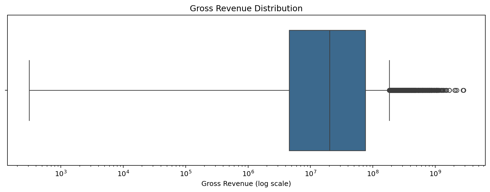
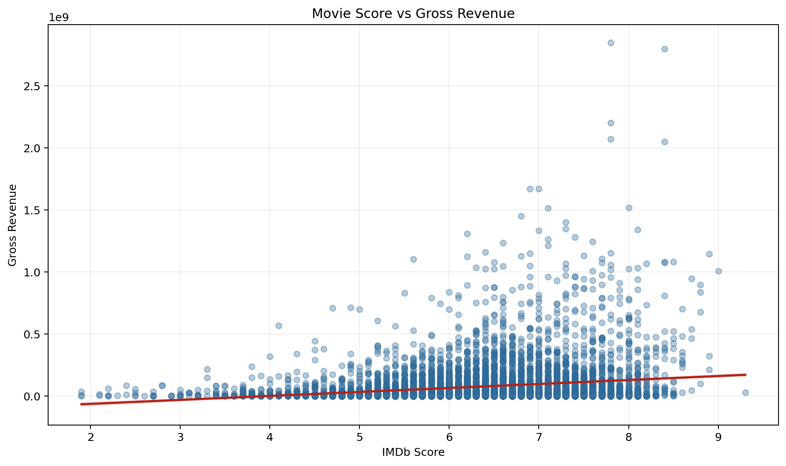
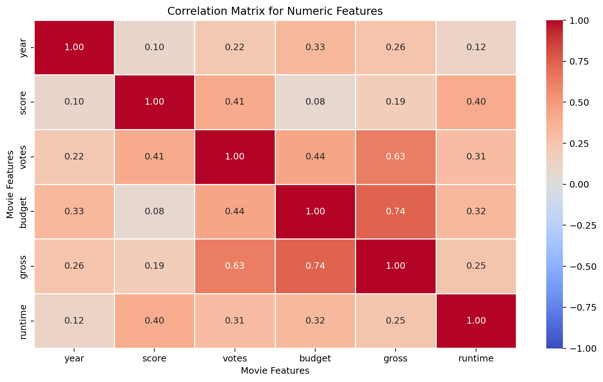
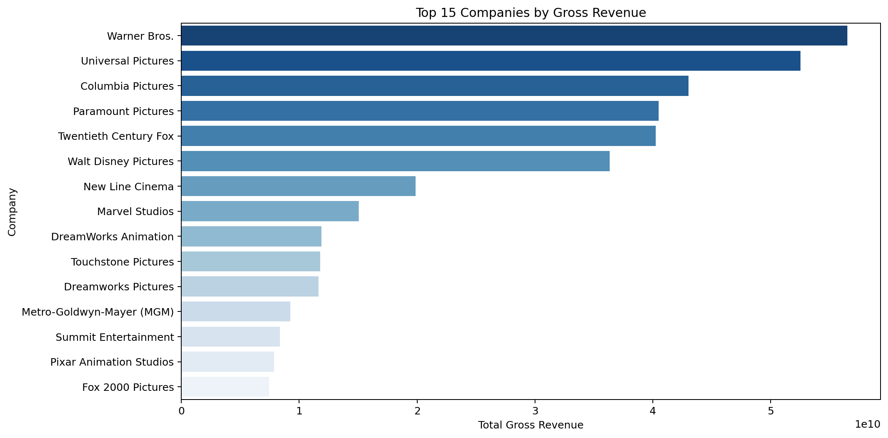

# Movie Revenue Correlation Analysis

**A Python notebook analysis of movie revenue drivers using correlation, categorical encoding, and revenue concentration by studio.**

This project investigates which movie attributes are most associated with gross revenue. It starts with a common analytics mistake: reducing a dataframe to numeric columns and accidentally losing business fields like `company`. The final notebook fixes that issue by preserving the original dataset, using separate working dataframes, and building a cleaner analysis story.

The goal is not to claim that correlation proves why movies earn more. The goal is to identify useful signals, communicate them clearly, and keep the analysis reproducible.

## Business Question

Which available movie features appear most related to gross revenue?

The analysis focuses on:

- Budget
- Votes
- IMDb score
- Runtime
- Year
- Company
- Genre

## Key Findings

| Finding | Interpretation |
| --- | --- |
| Gross revenue is highly skewed | A small number of movies generate very large revenue, so log-scale visuals make the distribution easier to read. |
| Budget and votes are stronger revenue signals than score | Audience engagement and production scale appear more connected to gross revenue than rating alone. |
| Score has visible variation | Higher-rated movies do not automatically earn more. Score is useful context, not a complete explanation. |
| Warner Bros. leads total gross revenue in this dataset | Studio-level totals help show market concentration across companies. |
| Encoded categories require caution | Turning text labels into numeric codes can help exploration, but category codes are not true measured quantities. |

## Notebook Visuals

The images below are exported from the main notebook outputs so the README can show the analysis without requiring a reviewer to open the notebook first.

### 1. Gross revenue has large outliers

The distribution of `gross` revenue is heavily skewed. A log-scale boxplot makes the outliers visible without letting the largest movies flatten the rest of the distribution.



### 2. Score alone does not explain revenue

The regression plot shows the relationship between IMDb score and gross revenue. There is some pattern, but the spread is wide. This supports the idea that movie revenue depends on more than rating alone.



### 3. Numeric correlations provide the first signal

The numeric correlation matrix compares `year`, `score`, `votes`, `budget`, `gross`, and `runtime`. This is the safest correlation view because all columns represent actual numeric measurements.



### 4. Company totals show revenue concentration

Grouping by `company` shows which studios generate the highest total gross revenue in the dataset. This step only works if the original dataframe keeps categorical columns intact.



## The Technical Fix

The key issue during development was accidentally reducing `df` to only numeric columns:

```python
df = df.select_dtypes(include=["number"])
```

That made correlation easier, but it removed columns such as `company`, `genre`, `director`, and `star`.

The corrected approach is:

```python
numeric_df = df.select_dtypes(include=["number"])
```

This preserves the full `df` while creating a separate dataframe for numeric correlation.

For encoded categorical exploration, the notebook also uses:

```python
df_numerized = df.copy()
```

That prevents category coding from overwriting the original text fields.

## Project Files

| File | Purpose |
| --- | --- |
| [notebooks/movies.ipynb](notebooks/movies.ipynb) | Main analysis notebook |
| [data/movies.csv](data/movies.csv) | Source movie dataset |
| [assets/](assets/) | Notebook visual exports used in this README |

## Skills Demonstrated

- Python data analysis
- pandas dataframe handling
- seaborn and matplotlib visualization
- Correlation analysis
- Categorical encoding
- Data quality review
- Analytical storytelling
- Debugging analysis workflow errors

## How to Run

Install dependencies:

```bash
pip install pandas numpy seaborn matplotlib
```

Open the notebook:

```text
notebooks/movies.ipynb
```

Run all cells from the top. The notebook is designed so `df` remains the full dataset throughout the analysis. The README visuals are exported from the notebook outputs.

## Limitations

- Correlation does not prove causation.
- Encoded categorical correlations should be interpreted carefully because category codes are arbitrary labels.
- The dataset includes missing values in fields such as `budget`, `gross`, `rating`, and `company`.
- Revenue is highly skewed, so averages and correlations can be affected by blockbuster outliers.

## Conclusion

This project demonstrates a practical analytics workflow: inspect the dataset, preserve source fields, separate numeric and categorical analysis, visualize relationships, and communicate findings without overstating the results.

The strongest portfolio value is not just the final charts. It is the corrected analysis process: identifying a dataframe mistake, fixing it with safer data handling, and turning the work into a readable revenue-correlation case study.
